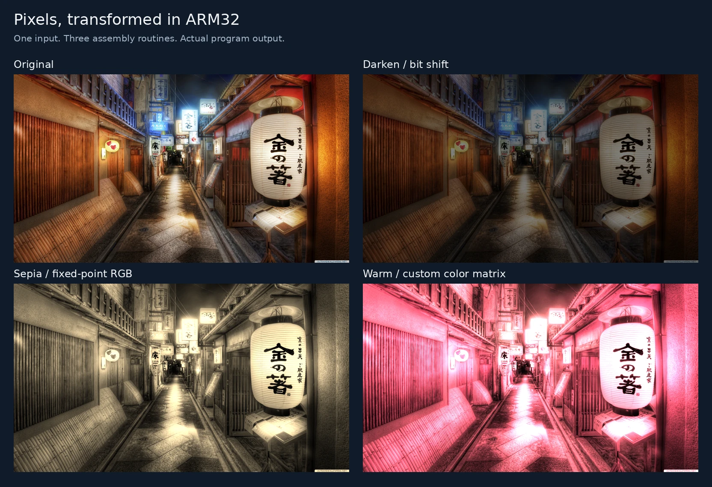
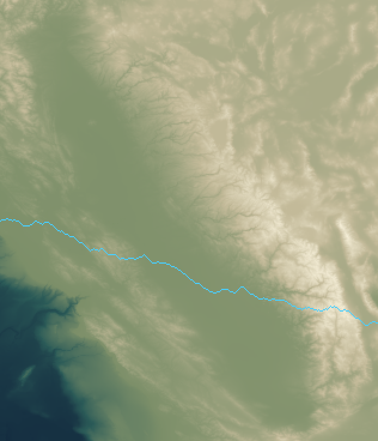
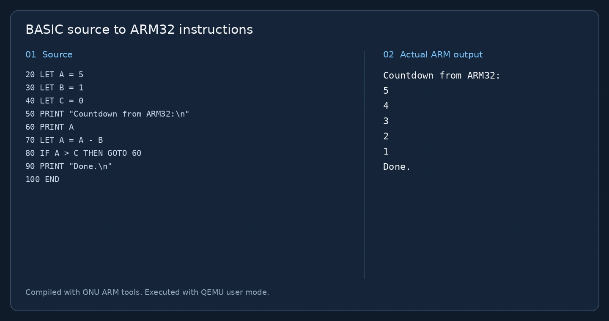

# ARM32 Systems Lab

**Brandon Vaquilar · Computer Organization and Assembly Language Programming**

A collection of ARM32 coursework exploring arithmetic, control flow, image processing, terrain traversal, and a small BASIC-to-assembly compiler. C and C++ drivers call hand-written ARM routines through the C ABI.

**Start with the results below. No installation is needed to view the images or [console transcript](docs/assets/console-output.txt).** A responsive [gallery page](docs/index.html) is also included for static hosting.



The three filters operate on planar RGB buffers. Darkening uses a bit shift; sepia and the custom warm filter use integer color matrices with saturation at 255. The input image was already bundled with the coursework repository; it is not presented as original photography.

## Terrain traversal



The cyan route is selected by the ARM assembly routine. At each column it chooses the smallest absolute elevation change among east, northeast and southeast. Ties prefer east, then northeast, then southeast. The C++ driver colors the elevation data for display. This is a greedy local route, not a globally optimal path.

## A tiny compiler



The compiler translates line-numbered BASIC into ARM32 assembly. The example above is assembled with GNU tools and executed with QEMU. Supported exercises include integer variables, `LET`, `PRINT`, `INPUT`, `IF`/`ELSE`, `GOTO`, `REM` and `END`.

## Project map

| Folder | Exercise | Current status |
| --- | --- | --- |
| `asm_first/` | Four signed arithmetic routines | Built and tested |
| `asm_fizzbuzz/` | Branching and calls into C | Full 1–100 output tested |
| `asm_spongebob/` | Seeded mixed-case text conversion | Compared with a C++ reference |
| `asm_image/` | Darken, sepia and custom warm filter | Pixel output tested; previews included |
| `bridges_mountains45/` | Greedy traversal of elevation grids | Offline driver and boundary tests |
| `asm_compiler/` | Small BASIC-to-ARM compiler | Sample programs assembled and executed |
| `code_tennis/` | Paired image/array exercise | Historical exercise; second routine is incomplete |

The original coursework folders and contributor comments are preserved. The current build adds portable drivers, regression checks, corrected FizzBuzz and terrain logic, compiler fixes, and reproducible visual previews. These maintenance changes should be distinguished from the original coursework when describing the project.

## Build on Ubuntu or Debian Linux

These instructions target an x86 Linux host. On Windows, use an Ubuntu WSL environment.

```bash
sudo apt update
sudo apt install build-essential g++-arm-linux-gnueabihf qemu-user python3
git clone https://github.com/BrandonVaquilar/Computer-Organization-and-Assembly-Language-Programming.git
cd Computer-Organization-and-Assembly-Language-Programming
make -j2
make test
```

The root Makefile writes generated files into `build/`. Individual maintained project Makefiles forward to this build. On **32-bit ARM Linux** with a native compiler, use `make CROSS_COMPILE= RUNNER=` and `make test CROSS_COMPILE= RUNNER=`. A 64-bit ARM machine still needs an ARM32 cross toolchain/runtime unless it provides a compatible native setup.

```bash
# Console exercises
qemu-arm -L /usr/arm-linux-gnueabihf build/arithmetic
qemu-arm -L /usr/arm-linux-gnueabihf build/fizzbuzz
printf '42\nexamples/message.txt\n' | qemu-arm -L /usr/arm-linux-gnueabihf build/spongebob

# Offline terrain image; the Tahoe dataset is 63 columns by 48 rows
qemu-arm -L /usr/arm-linux-gnueabihf build/terrain bridges_mountains45/tahoe.dat 24 build/tahoe.ppm

# Compile BASIC, assemble the generated ARM source, then execute it
build/bb8 build/countdown.s < examples/countdown.bas
arm-linux-gnueabihf-g++ -marm -Wl,-z,noexecstack build/countdown.s build/print.o -o build/countdown
qemu-arm -L /usr/arm-linux-gnueabihf build/countdown
```

The headless image driver accepts binary RGB PPM files, with no CImg or window system dependency:

```bash
qemu-arm -L /usr/arm-linux-gnueabihf build/image_filters sepia input.ppm build/sepia.ppm
# Other filters: darken, warm
```

## Regenerate the gallery

```bash
sudo apt install python3-pil
make previews
python3 -m http.server 8000 --directory docs
```

Open `http://localhost:8000` to review the static gallery. The committed images are ready for GitHub README rendering and static hosting. Publishing to GitHub Pages is a separate repository setting; this change does not enable hosting or change a domain.

`scripts/generate_previews.py` runs the actual ARM binaries. Pillow converts image formats, resizes results and draws captions; it does not replace the assembly filters or path selection. The [provenance manifest](docs/assets/provenance.json) records commands and their output. The [plain-text transcript](docs/assets/console-output.txt) contains the full FizzBuzz run and other console examples.

## Verification and limitations

`make test` checks 4,000 signed arithmetic results, 36 image-filter cases with exact channel values and output guards, 384 terrain routes including edge rows and ties, the complete FizzBuzz output, seeded text conversion, empty/missing files, and several compiled BASIC programs.

The BASIC language is a teaching subset. Variables are `A B C I J X Y Z`; arithmetic expressions use two variables with `+`, `-` or `*`, while standalone assignments accept integer literals. `IF` compares variables. It does not implement a general expression parser, runtime overflow checks, or comprehensive syntax diagnostics. Short examples are the intended scope.

The unfinished NEON experiment in `asm_image/student_filter.s` and the historical `code_tennis/` harness are excluded from the maintained build. The original CImg and BRIDGES drivers remain as reference sources; they require external course dependencies. The offline terrain preview needs no network account. If using the legacy BRIDGES driver, provide `BRIDGES_USERNAME` and `BRIDGES_API_KEY` through your environment. Any previously committed API key should be rotated because removing it from the latest source does not remove Git history.

## Where to edit

| Change | Location |
| --- | --- |
| ARM algorithms | Existing project folders, `*.s` |
| Image / terrain file handling | Each project's `preview.cc` |
| Shared input and image helpers | `include/` |
| Build configuration | Root `Makefile` |
| Regression checks | `tests/` and `scripts/test.py` |
| Preview generation | `scripts/generate_previews.py` |
| Recruiter-facing page and images | `docs/` |

For a portfolio card, use **ARM32 Systems Lab** with the description: “ARM assembly coursework covering image filters, greedy terrain traversal and a small BASIC compiler, with output previews and reproducible checks.” Link to this repository in a new tab and use `docs/assets/filters-comparison.webp` as the project thumbnail. No AI functionality is claimed for these exercises.

## References and attribution

- [QEMU user-mode documentation](https://www.qemu.org/docs/master/user/main.html)
- [Arm 32-bit procedure call standard](https://github.com/ARM-software/abi-aa/blob/main/aapcs32/aapcs32.rst)
- Original assignment text and starter/contributor comments are retained in the project folders. The supplied Code Tennis package retains its own license in `code_tennis/tennis-45/LICENSE`.
